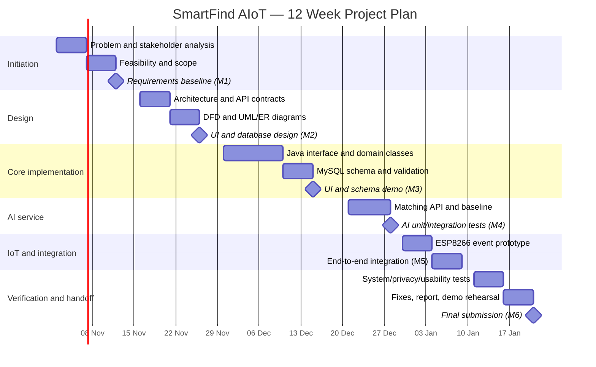

# Project Completion Schedule — SmartFind AIoT

**Process model:** Agile-inspired iterative development  
**Duration:** 12 weeks (relative schedule; align to actual course calendar)

## Gantt chart

> Dates are illustrative and use a proposed start of 2 November 2026. Shift the chart to match the actual course deadline. Work may overlap if the developer has capacity.

## Milestones and acceptance criteria

| Milestone | Target | Acceptance criteria | Deliverables |
|---|---|---|---|
| M1 Requirements baseline | End of Week 2 | Scope, stakeholder needs, requirements, and risks documented | Proposal/SRS |
| M2 Design baseline | End of Week 4 | All six required diagrams and API/data design available | Design package |
| M3 UI + schema | End of Week 6 | Java Swing prototype runs; SQL schema reviewed | Java UI, SQL |
| M4 AI matching demo | End of Week 8 | Python endpoint ranks candidates and passes baseline tests | Flask service, tests |
| M5 IoT integration | End of Week 10 | Intake event is accepted or simulated end-to-end; duplicates handled by design | Firmware, event spec |
| M6 Final verification | End of Week 12 | Test evidence, evaluation, limitations, final proposal/report, and demo ready | Final submission |

## Work breakdown structure

1. Project initiation and feasibility
2. Requirements elicitation and specification
3. Architecture and data design
4. UML/DFD/ER modeling
5. Java interface and domain layer
6. MySQL schema
7. Python AI matching endpoint
8. ESP8266 intake-event firmware
9. Integration and test
10. Privacy/security review
11. Evaluation and documentation
12. Demonstration and submission

## Progress tracking

Use GitHub Issues or a project board with columns: Backlog, Ready, In Progress, Review/Test, Done. Each issue should include acceptance criteria and link to the relevant deliverable. Commit small, meaningful changes; tag milestones when the corresponding acceptance criteria are met.
